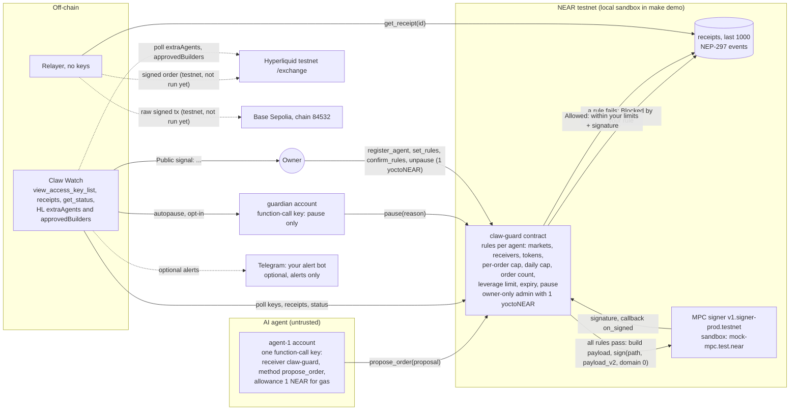
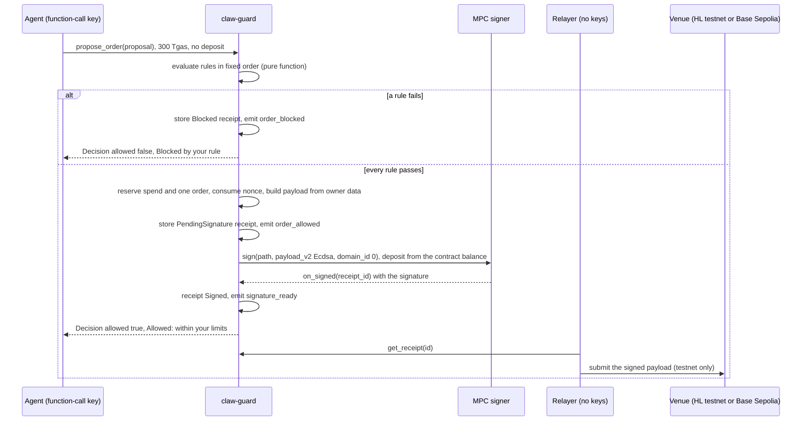

# Claw Guard architecture

Prototype. Testnet only. Not audited.
The server never holds mainnet keys or signs for users.

This page describes what is in the repository on 31 Oct 2026. Everything marked "sandbox" was run
in the build container. On NEAR testnet the deploy, `register_agent`, the agent's orders and the
real MPC `sign` calls ran on 31 Oct 2026 with the owner's go ([VERIFY.md](VERIFY.md), sections (h)
and (i)); the steps marked "Testnet; not run yet" (Hyperliquid testnet and Base Sepolia) have not
been run (owner go).

## 1. Components and who holds which key

| Component | Code | Account (sandbox / testnet) | Keys it holds |
|---|---|---|---|
| Agent (scripted, or optional LLM mode) | [offchain/src/agent](../offchain/src/agent) | `agent-1.test.near` / `agent-1.<owner>.testnet` | One NEAR **function-call key**: receiver = the claw-guard contract, methods = `["propose_order"]`, allowance 1 NEAR (gas only). No full-access key, no EVM key. The agent CLI refuses to start with any other kind of key. LLM mode also holds `LLM_API_KEY` (model access only). |
| Policy contract `claw-guard` | [contracts/claw-guard](../contracts/claw-guard) | `clawguard.test.near` / `clawguard.<owner>.testnet` | No private keys in code or state. It is the only caller that can get MPC signatures for its derived addresses, because the MPC derives the key from the caller account id and the path. The contract *account* has one full-access key: a throwaway key in the sandbox, the owner's public key on testnet (`setup:testnet`); locking it is an owner decision (Q-14). |
| MPC signer | NEAR network / [contracts/mock-mpc](../contracts/mock-mpc) | `mock-mpc.test.near` / `v1.signer-prod.testnet` | Testnet: NEAR's threshold key. Sandbox: a public test key per (caller, path), `keccak256("clawguard-sandbox-only:" ‖ caller ‖ "," ‖ path)`: sandbox test key, worthless, never use anywhere else. |
| Owner | human | `owner.test.near` / `<owner>.testnet` | Full-access key (trusted). On the Hyperliquid path also a throwaway **testnet-only** EVM key, the Hyperliquid testnet master account that approves the derived address as an API wallet. |
| Guardian (optional) | — | `guardian.test.near` / `GUARDIAN_ACCOUNT_ID` | One function-call key: receiver = contract, methods = `["pause"]`. |
| Relayer | [offchain/src/relayer](../offchain/src/relayer) | none | **No keys.** Reads a `Signed` receipt and submits it (testnet only). |
| Claw Watch | [offchain/src/watch](../offchain/src/watch) | none | No keys, except the guardian's pause-only key when `CLAW_WATCH_AUTOPAUSE=1`. |
| Telegram module (optional) | [offchain/src/watch/telegram.ts](../offchain/src/watch/telegram.ts) | none | Only the owner's own bot token (`TELEGRAM_BOT_TOKEN`) and chat id, in `offchain/.env`. No NEAR or EVM keys. |

The sandbox setup ([offchain/src/cli/setup.ts](../offchain/src/cli/setup.ts) and
[tests/common/mod.rs](../tests/common/mod.rs)) creates `agent-1` and `guardian` in one batch each
(`CreateAccount` + `Transfer 0.5 NEAR` + `AddKey(FunctionCall)`), so those accounts never have a
full-access key. `mock-mpc` and `claw-guard` are each deployed and initialised in one batch signed
by their own account (`new` is `#[init] #[private]`).

## 2. Diagram



Notes on the diagram: the sandbox MPC stand-in is shown, the guardian is a separate account with
a pause-only key, Claw Watch also reads receipts and `get_status`, and the venue edges are dotted
because they have not been run yet.

## 3. Core flow



### Hyperliquid testnet path (`HlTestnet`, path `hl-testnet-1`)

1. The owner deploys `claw-guard` and registers the agent with its rules (`register_agent`, 1 yoctoNEAR).
2. The owner creates the agent account in one batch with only the function-call key.
3. The owner derives the EVM address for (`claw-guard`, `hl-testnet-1`)
   (`npm --prefix offchain run derive -- --path hl-testnet-1`) and approves it on Hyperliquid
   testnet as an API wallet with the testnet-only master key (`approve-hl-agent`). An API wallet
   can place and cancel orders but cannot withdraw. *Testnet; not run yet.*
4. The agent calls `propose_order({target:"HlTestnet", order:{HlOrder:{…}}})` with 300 Tgas.
5. The contract checks the caller is a registered agent (else panic `ERR_NOT_AGENT`, nothing
   stored) and runs `rules::evaluate`. On the first failing rule it stores a `Blocked` receipt,
   emits `order_blocked` and returns the decision. It does not panic, so the receipt stays.
   A proposal that does not fit the typed JSON (an unknown order kind, an out-of-range number)
   fails earlier, in near-sdk's argument parsing: nothing is signed, but no receipt or event is
   stored (design question Q-47).
6. If every rule passes it checks gas first (`ERR_NOT_ENOUGH_GAS`, before any write), reserves the
   spend and one order for today, consumes the nonce, builds the canonical Hyperliquid action from
   the owner's asset index plus the checked fields, computes the EIP-712 digest itself (phantom
   agent source `"b"` is a compile-time constant), stores a `PendingSignature` receipt with
   `payload_hash` and the action JSON as `signed_body`, emits `order_allowed`, and calls the MPC
   `sign` with `sign_deposit_yocto` from its own balance (function-call keys cannot attach one),
   then `on_signed` with 20 Tgas.
7. `on_signed`: success → `Signed`, signature stored, `signature_ready`, `Allowed: within your
   limits`. Any failure (failed call, response over 1024 bytes, unusable signature) → `SignFailed`,
   `Not signed: the signature request failed`, `signature_failed`, reservation released if it is
   still the same UTC day and the same registration. The nonce stays consumed (on the Base
   Sepolia path this stalls later transfers until the owner resets the agent, Q-46). Neither
   `pause` nor tightened rules revoke a signature already issued (Q-45).
8. The relayer reads the receipt, recomputes the digest from `signed_body`, checks the signer is
   the derived address, and POSTs `{action, nonce, signature:{r,s,v}, vaultAddress:null,
   expiresAfter:null}` to `https://api.hyperliquid-testnet.xyz/exchange`. *Testnet; not run yet.*
9. Claw Watch polls keys, receipts, pause state and (testnet) API wallets; see §6.

### Base Sepolia path (`BaseSepolia`, path `base-sepolia-1`)

Same flow with `order:{EvmTransfer:{token, to, amount, nonce, gas_limit, max_fee_per_gas,
max_priority_fee_per_gas}}`. The contract looks up the token address in the owner's rules, builds
the unsigned EIP-1559 transaction (chain id 84532 is a constant, value 0, empty access list,
ERC-20 `transfer(to, amount)` calldata) and signs `keccak256(0x02 ‖ rlp(tx))`. The signature uses
`v` = y-parity (0/1). The relayer checks `eth_chainId` = `0x14a34`, checks that the transaction's
nonce is the signer's pending nonce (`eth_getTransactionCount`; a lower one is already used, a
higher one would only wait in the queue), attaches the signature and broadcasts the raw transaction. The derived address needs Base Sepolia gas and test USDC.
*Testnet; not run yet.* In the sandbox, the EVM `signed_body` and `payload_hash` equal the viem
2.57.7 vector byte for byte.

## 4. Contract interface

### Initialisation

`new(owner_id, guardian_id, mpc_contract_id, sign_deposit_yocto: U128, sign_gas_tgas: u64,
loosen_delay_sec: u64)`, `#[init] #[private]`. Panics `ERR_MAINNET_REFUSED` unless the contract
account and `mpc_contract_id` both end in `.testnet` or both end in `.test.near`. The setup
scripts use `sign_gas_tgas` 100, `loosen_delay_sec` 600 and `sign_deposit_yocto` 1.
`mpc_contract_id` has no setter, and there is no `set_owner`.

### Methods

| Method | Caller | Deposit | Effect | Panics |
|---|---|---|---|---|
| `propose_order(proposal)` | registered agent | none (not payable) | evaluate, then receipt + event, and MPC `sign` if allowed | `ERR_NOT_AGENT`, `ERR_NOT_ENOUGH_GAS` |
| `on_signed(receipt_id)` | contract itself (`#[private]`) | — | signature into receipt, or `SignFailed` + release | `ERR_NO_PENDING_SIGNATURE` |
| `register_agent(agent_id, rules)` | owner | exactly 1 yocto | add agent, rules version 1, `agent_registered`; the rules apply at once, with no loosening delay (Q-43) | `ERR_NOT_OWNER`, `ERR_AGENT_EXISTS`, `ERR_INVALID_RULES` |
| `remove_agent(agent_id)` | owner | 1 yocto | remove, `agent_removed` | `ERR_NOT_OWNER`, `ERR_NOT_AGENT` |
| `set_rules(agent_id, rules)` | owner | 1 yocto | tighter-or-equal: apply now, `rules_updated` (`tightened: true`); any loosening: pending until now + `loosen_delay_sec`, `rules_pending` | `ERR_NOT_OWNER`, `ERR_NOT_AGENT`, `ERR_INVALID_RULES` |
| `confirm_rules(agent_id)` | owner | 1 yocto | apply pending after its eta, `rules_updated` (`tightened: false`) | `ERR_NO_PENDING_RULES`, `ERR_TOO_EARLY`, `ERR_INVALID_RULES` |
| `cancel_pending_rules(agent_id)` | owner (1 yocto) or guardian (none) | see caller | drop pending rules | `ERR_NOT_OWNER_OR_GUARDIAN`, `ERR_NO_PENDING_RULES` |
| `pause(reason)` | owner or guardian | none | pause every agent; reason ≤ 140 bytes (UTF-8); `paused` | `ERR_NOT_OWNER_OR_GUARDIAN`, `ERR_REASON_TOO_LONG` |
| `unpause()` | owner | 1 yocto | lift the pause (idempotent), `unpaused` | `ERR_NOT_OWNER` |
| `set_guardian(guardian_id)` | owner | 1 yocto | set or clear the guardian | `ERR_NOT_OWNER` |
| `set_sign_config(sign_deposit_yocto, sign_gas_tgas)` | owner | 1 yocto | MPC deposit and static gas for later requests | `ERR_NOT_OWNER` |

Owner methods check the caller first, then the deposit (near-sdk's
`Requires attached deposit of exactly 1 yoctoNEAR`).

### Views

| View | Returns |
|---|---|
| `get_status()` | `{owner, guardian, paused, pause_reason, mpc_contract_id, agents_count, receipts_count}` |
| `get_rules(agent_id)` | `{rules, rules_version, pending, day, spent_today, orders_today, last_hl_nonce_ms, last_evm_nonce}` as of the current UTC day, or `null` |
| `get_receipt(id)` | one receipt or `null` |
| `get_receipts(from_id, limit)` | up to 50 receipts from `from_id` |
| `get_paths()` | `[["HlTestnet","hl-testnet-1"],["BaseSepolia","base-sepolia-1"]]` |
| `preview_payload(agent_id, proposal)` | `{"Ok": "<payload_hash>"}` or `{"Err": "<decision message>"}`; same evaluation, nothing stored |

### Receipt

`{id, agent_id, target, proposal, status, rule_code, message, payload_hash, signed_body,
derivation_path, signature:{r,s,v}, rules_version, block_height, timestamp_ns}`. `status` is
`Blocked`, `PendingSignature`, `Signed` or `SignFailed`. `payload_hash` is exactly what the MPC
signed; `signed_body` is the Hyperliquid action JSON or the unsigned EIP-1559 transaction (hex).
Receipt ids start at 1. The contract keeps the last 1000 (`max_receipts`); older ones survive only
as events. Blocked receipts store agent-supplied strings cut to 48 bytes (memo to 140 bytes),
never inside a character. A blocked order is stored only while the contract keeps its storage
reserve (below); otherwise its decision and `order_blocked` event carry `receipt_id` `"0"`.

### Events (NEP-297)

Logged as `EVENT_JSON:{"standard":"clawguard","version":"1.0.0","event":"<name>","data":[{…}]}`.

| Event | Data fields |
|---|---|
| `agent_registered`, `agent_removed` | `agent_id`, `rules_version` |
| `rules_updated` | `agent_id`, `rules_version`, `tightened` |
| `rules_pending` | `agent_id`, `eta_ns` |
| `order_blocked` | `receipt_id`, `agent_id`, `target`, `rule_code`, `message` |
| `order_allowed` | `receipt_id`, `agent_id`, `target`, `payload_hash`, `derivation_path` |
| `signature_ready` | `receipt_id`, `payload_hash` |
| `signature_failed` | `receipt_id`, `reason` |
| `paused` | `by`, `reason` |
| `unpaused` | `by`, `reason` (the reason it cleared, or `null`) |

`set_guardian` and `cancel_pending_rules` emit no event (design question Q-02).

### Rule evaluation

`rules::evaluate` is a pure function; the first failure wins, in this order: `PAUSED`, `EXPIRED`,
`TARGET_NOT_ENABLED`, `MALFORMED`, `STALE_NONCE`, `MARKET_NOT_ALLOWED` / `TOKEN_NOT_ALLOWED`,
`RECEIVER_NOT_ALLOWED`, `LEVERAGE_ABOVE_LIMIT`, `REDUCE_ONLY_REQUIRED`, `ORDER_ABOVE_CAP`,
`DAILY_ORDER_COUNT`, `DAILY_CAP`, `INSUFFICIENT_CONTRACT_BALANCE`. The day is
`floor(block_timestamp / 86400 s)` (UTC). Hyperliquid notional = `ceil(px × sz)` in 1e-6 quote
units with checked arithmetic (overflow → `MALFORMED`), where `px` is the agent's limit price for
buys and sells alike; for a sell that is only a lower bound on the fill (design question Q-42). A
leverage update counts as one order with zero notional. The contract-balance floor is
`(storage_usage + 4096) × storage_byte_cost + sign_deposit_yocto`.
EVM bounds (else `MALFORMED`): `21000 ≤ gas_limit ≤ 200000`, `max_fee_per_gas ≤ 100 gwei`,
`max_priority_fee_per_gas ≤ max_fee_per_gas`, `nonce ≤ 2^53 − 1` (the largest nonce the off-chain
relayer can carry).

### Payloads the contract builds

Hyperliquid (key order matters for msgpack; confirmed against hyperliquid-python-sdk 0.24.0
vectors):

```json
{"type":"order","orders":[{"a":3,"b":true,"p":"50000","s":"0.001","r":false,"t":{"limit":{"tif":"Gtc"}}}],"grouping":"na"}
{"type":"updateLeverage","asset":3,"isCross":true,"leverage":3}
```

`connectionId = keccak256(msgpack(action) ‖ nonce (8 bytes big-endian) ‖ 0x00)` (no vault, no
`expiresAfter`, so a signed order stays submittable for as long as Hyperliquid accepts its nonce,
about 2 days; Q-45). Digest: EIP-712 with domain `{name:"Exchange", version:"1", chainId:1337,
verifyingContract:0x0…0}` and type `Agent(string source, bytes32 connectionId)`, `source = "b"`
(testnet). msgpack is a small hand-rolled encoder ([msgpack.rs](../contracts/claw-guard/src/msgpack.rs))
that matches Python `msgpack.packb` byte for byte.

Base Sepolia: unsigned EIP-1559 transaction `0x02 ‖ rlp([84532, nonce, max_priority_fee_per_gas,
max_fee_per_gas, gas_limit, token, 0, transfer(to, amount), []])`, hashed with keccak256.

### MPC request and response

Request (from `near/mpc` `main` source; `v1.signer-prod.testnet` accepted it and answered 7 times in the 31 Oct 2026 testnet run, [VERIFY.md](VERIFY.md) section (h)):
`{"request":{"path":"hl-testnet-1","payload_v2":{"Ecdsa":"<64 hex>"},"domain_id":0}}`.
Response: `{"scheme":"Secp256k1","big_r":{"affine_point":"02|03…"},"s":{"scalar":"…"},"recovery_id":0|1}`,
parsed leniently (missing `scheme`, `0x` or upper-case hex accepted). Conversion: `r` = x coordinate
of `big_r` (prefix byte dropped), `s` = `scalar`, `v = recovery_id + 27` for Hyperliquid and
`v = recovery_id` (y-parity) for EIP-1559.

## 5. Off-chain modules (TypeScript, Node 22)

| Module | Role |
|---|---|
| [config.ts](../offchain/src/config.ts) | Loads env (works without `.env`); testnet guards (`ERR_MAINNET_REFUSED`); secrets wrapped so they never print; redacting logger. |
| [near.ts](../offchain/src/near.ts) | near-api-js 7.4.0 wrappers and a typed client for every contract method (owner methods attach 1 yocto; `propose_order` 300 Tgas, no deposit); checks the RPC's chain id. |
| [types.ts](../offchain/src/types.ts) | Wire types mirroring `types.rs`, with fail-closed parsers. |
| [derive.ts](../offchain/src/derive.ts) | Derived EVM address per (contract, path): mock formula in the sandbox; testnet MPC derivation (prefers the MPC `derived_public_key` view online). |
| [hl.ts](../offchain/src/hl.ts) | Hyperliquid msgpack + EIP-712 digest and the `approveAgent` typed data (testnet constants only). |
| [sig.ts](../offchain/src/sig.ts) | `verify-sig`: recompute `payload_hash` from `signed_body`, recover the signer, compare with the derived address (`MATCH` / `MISMATCH`, Signed receipts only); a receipt with no signature by design prints `no signature (blocked)`, `no signature (signature request failed)` or `no signature yet (pending)` (exit 0), or `MISMATCH` (exit 1) if it still carries a signature. |
| [decode.ts](../offchain/src/decode.ts), [receipts_view.ts](../offchain/src/receipts_view.ts) | Plain-English "what is being signed" line, decoded strictly from the signed body (market and token names from the owner's rules for the signed asset index or token address); receipts table (control characters shown as escapes). |
| [agent/](../offchain/src/agent) | `scripted.ts` (normal scenario, step runner), `injection.ts` (the poisoned-message scenario), `llm.ts` (optional Claude agent with one tool), `index.ts` (CLI). |
| [relayer/](../offchain/src/relayer) | `hl.ts` (`/exchange` body), `base.ts` (raw EIP-1559 tx after an `eth_chainId` check and a pending-nonce check), `index.ts`. Refuses tampered bodies, wrong `v`, wrong chain, a signer mismatch or a nonce that is not the signer's next one. |
| [watch/](../offchain/src/watch) | `near_keys.ts`, `hl.ts`, `receipts.ts` (sources), `alerts.ts` (all alert wording), `snapshot.ts` (canonical JSON + sha256 baselines), `telegram.ts` (optional sender), `index.ts` (`ClawWatch`, autopause). |
| [cli/](../offchain/src/cli) | `demo`, `setup` (sandbox and testnet), `receipts`, `verify_sig`, `derive`, `relay`, `approve_hl_agent`, `gen_testnet_evm_key`, `gen_testnet_near_key`, `watch`. |

## 6. Claw Watch

Each poll: `view_access_key_list` for the owner, agent, contract and guardian accounts (snapshot of
public key, permission kind, receiver and methods; nonce and allowance ignored), the guard's
`get_status` and every receipt since the last poll (pages of 50), and on testnet with
`HL_MASTER_ADDRESS` the Hyperliquid testnet `/info` queries `extraAgents` and `approvedBuilders`.
The first poll is a baseline. Baselines are kept in `offchain/.sandbox/watch-<network>.json`
(git-ignored) with a sha256 so `--once` runs compare with the previous run. Autopause
(`CLAW_WATCH_AUTOPAUSE=1`) sends at most one guardian `pause("watch: <what changed>")` per poll for
a new key, a new API wallet, a new builder fee approval or 3+ blocked orders in 10 minutes.

## 7. Gas (sandbox measurements)

Measured on the local sandbox (neard 2.14.0, protocol 88) by the near-workspaces tests, in Tgas
burnt, on 31 Oct 2026 with the contract as in this repository (re-measure after contract changes:
`bash scripts/sandbox_env.sh cargo test -p claw-guard-tests --test sandbox_flow --test
pause_and_balance -- --nocapture`, lines starting with `GAS`). **The mock MPC numbers are sandbox-only**: the mock signs synchronously, while the real
`v1.signer-prod.testnet` `sign` yields until the MPC network answers; on NEAR testnet an allowed `propose_order` burnt about 14.4 Tgas in total, the MPC's two receipts 4.28 + 3.47 Tgas ([VERIFY.md](VERIFY.md) section (a)).

| Transaction | Total | Breakdown |
|---|---|---|
| `propose_order`, blocked (Hyperliquid) | 2.19 | contract receipt 1.87 |
| `propose_order`, blocked (Base Sepolia) | 2.25 | contract receipt 1.93 |
| `propose_order`, blocked `PAUSED` | 2.19 | tx 0.32 + 1.88 |
| `propose_order`, blocked `INSUFFICIENT_CONTRACT_BALANCE` | 2.21 | tx 0.32 + 1.89 |
| `propose_order`, allowed (Hyperliquid) | 21.60 | `propose_order` 3.14, **mock** `sign` 15.68, `on_signed` 2.02, refunds 0.44, tx conversion 0.32 |
| `propose_order`, allowed (Base Sepolia) | 21.50 | `propose_order` 3.02, **mock** `sign` 15.68, `on_signed` 2.04 |
| `propose_order`, MPC failure | 7.47 | failed **mock** `sign` 1.21, `on_signed` 2.14 |
| guardian `pause` | 1.81 | tx 0.31 + 1.50 |
| owner `unpause` | 1.79 | tx 0.31 + 1.48 |

Static gas: an allowed order needs `sign_gas_tgas` (100) + 20 (callback) + 10 (margin) Tgas left
when the check runs, otherwise `ERR_NOT_ENOUGH_GAS` before anything is written; the agent attaches
300 Tgas (140 Tgas was checked to be enough in the sandbox). Sandbox gas price observed:
1e9 yoctoNEAR per gas (300 Tgas reserves 0.3 NEAR of the agent's balance), which is why the sandbox
agent waits for each refund (`FINAL`) before the next proposal.

## 8. Storage notes

- Receipts: ring buffer of the last 1000; an allowed receipt is about 0.7 to 1 KB. At the storage
  cost the sandbox tests use (10^19 yoctoNEAR per byte, i.e. 0.01 NEAR per KB), a full buffer of
  allowed receipts holds roughly 7 to 10 testnet NEAR of storage, more than the 5 testnet NEAR the
  setup script gives the contract (design question Q-04).
- Blocked receipts are trimmed (agent strings 48 bytes, memo 140 bytes) to limit storage
  griefing: a worst-case blocked receipt is 702 bytes of storage (653 bytes of Borsh, pinned at
  most 700, plus key and record overhead), so a full ring is 7.02 NEAR. Blocked proposals cost the
  agent only gas and do not count toward `max_orders_per_day`, so with the 5 NEAR the setup gives
  the contract an agent can still reach the storage reserve (about 290 worst-case proposals). A
  blocked receipt is stored only while `balance >= (storage_usage + 4096 bytes) × byte cost`;
  below that the decision and the `order_blocked` event are unchanged but carry receipt id `"0"`
  and nothing is stored or signed. `pause` (at most 144 more bytes) therefore always fits; the
  owner adds NEAR to the contract to store receipts again (owner decision D-18, was Q-44).
- `INSUFFICIENT_CONTRACT_BALANCE` protects allowed orders: the contract keeps
  `(storage_usage + 4096 bytes) × byte cost + sign_deposit_yocto` before it requests a signature.
  The sandbox test shows this is exact: one yoctoNEAR below the floor is blocked with no promise,
  exactly at the floor is signed.
- Pending signatures are kept apart from receipts (`pending_signs`), so `on_signed` still releases
  a reservation after its receipt left the ring buffer.

## 9. Build

`scripts/build_contracts.sh` builds both contracts with `cargo near build non-reproducible-wasm`
(cargo-near 0.22.0, which runs `wasm-opt` and embeds the ABI), or with plain cargo when cargo-near
is missing (`-C link-arg=-s --cfg near`; about 20% bigger, no ABI; also passes the sandbox tests).
Sizes in the build container with cargo-near: `claw_guard.wasm` 288,800 bytes,
`mock_mpc.wasm` 197,147 bytes. The reproducible build (NEP-0330 image in
`contracts/claw-guard/Cargo.toml`) has not been run (Q-30).
